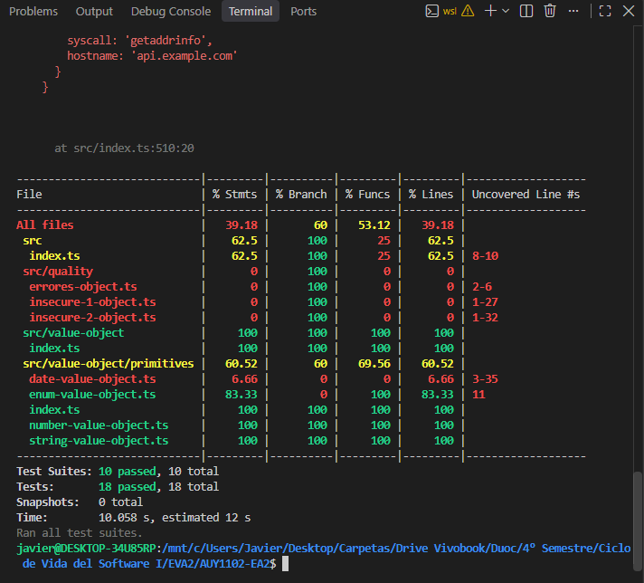
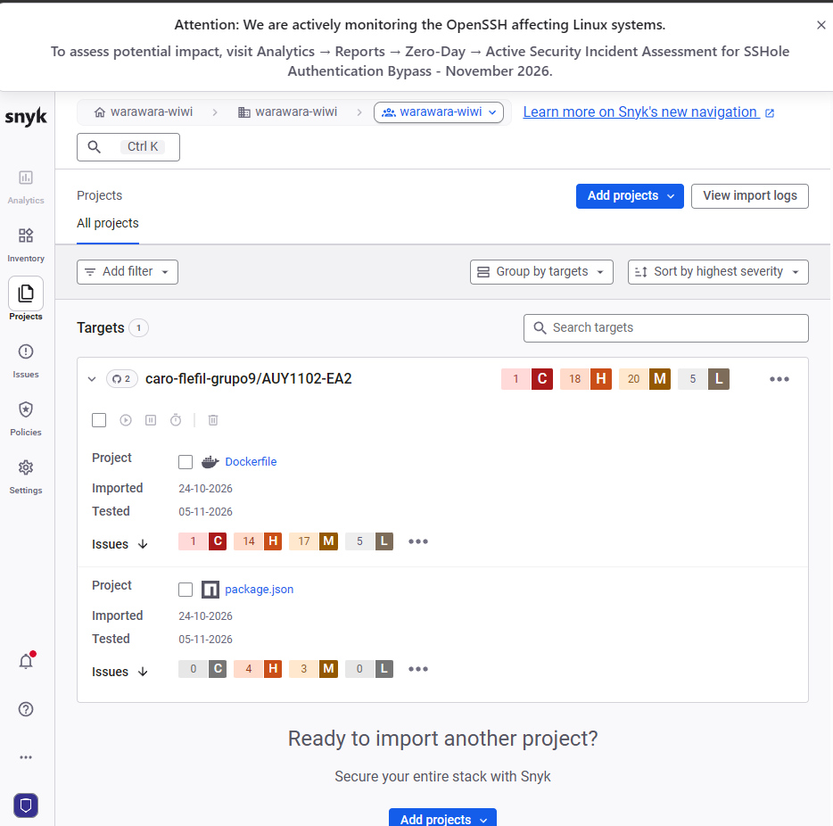
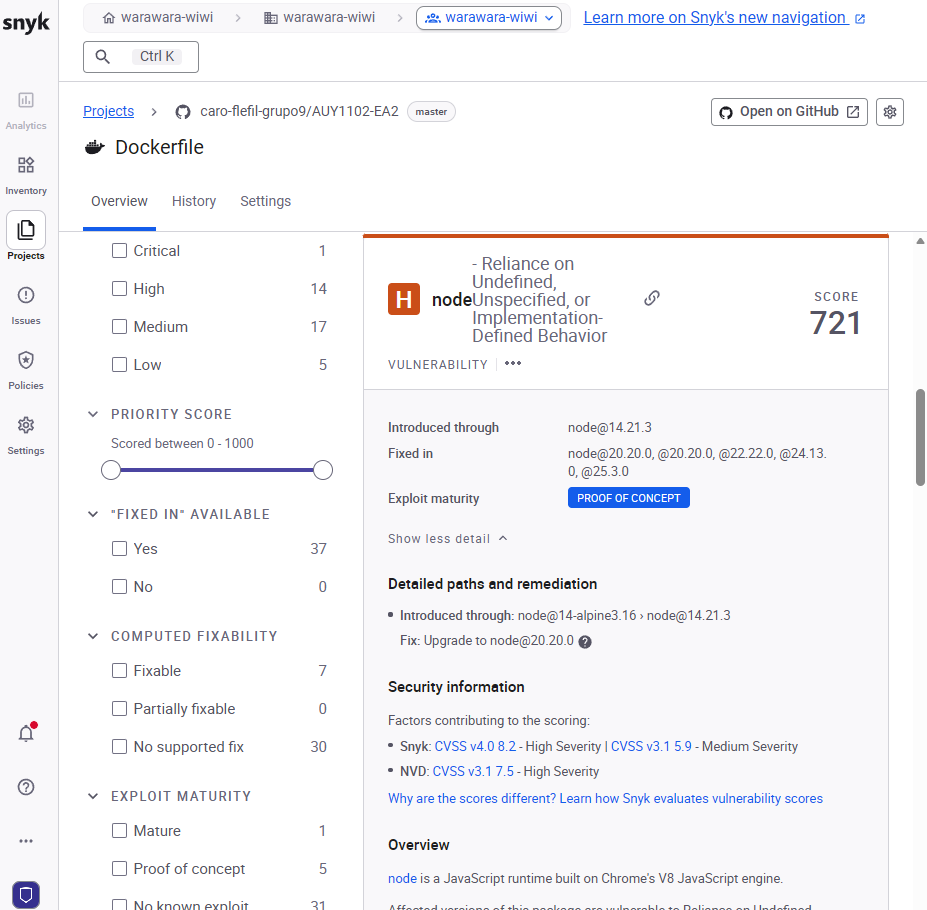
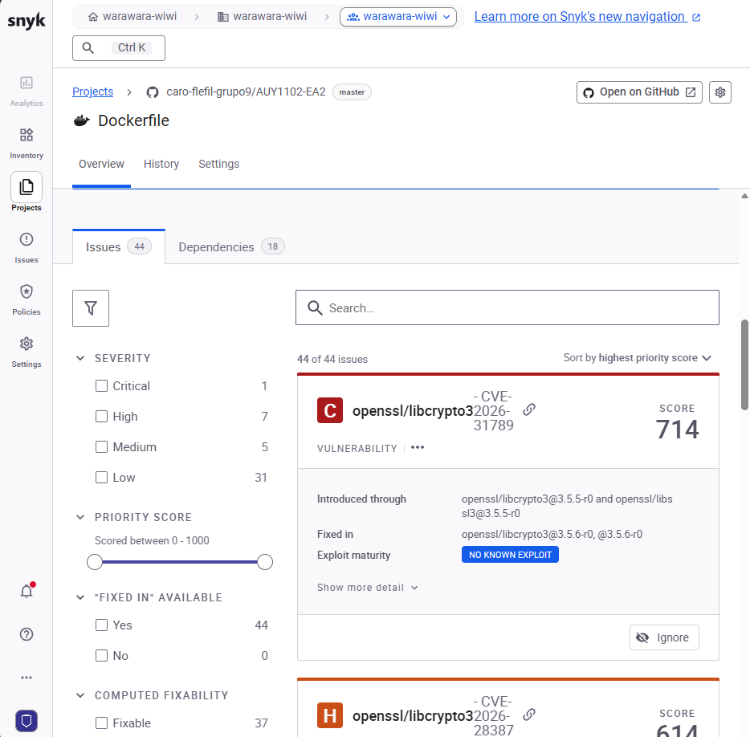
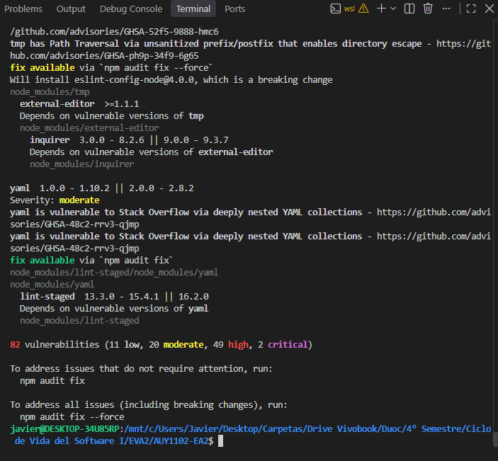
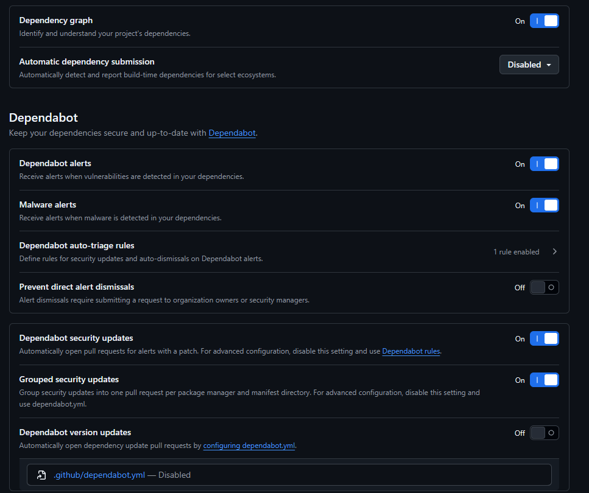
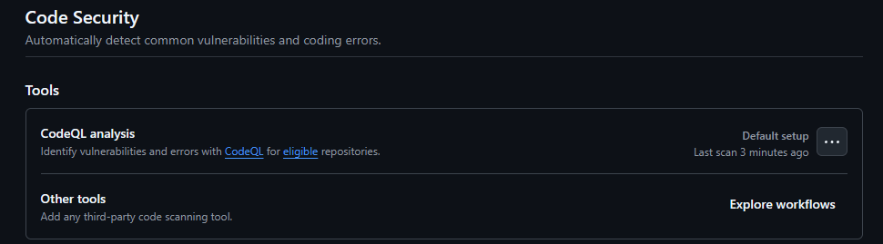
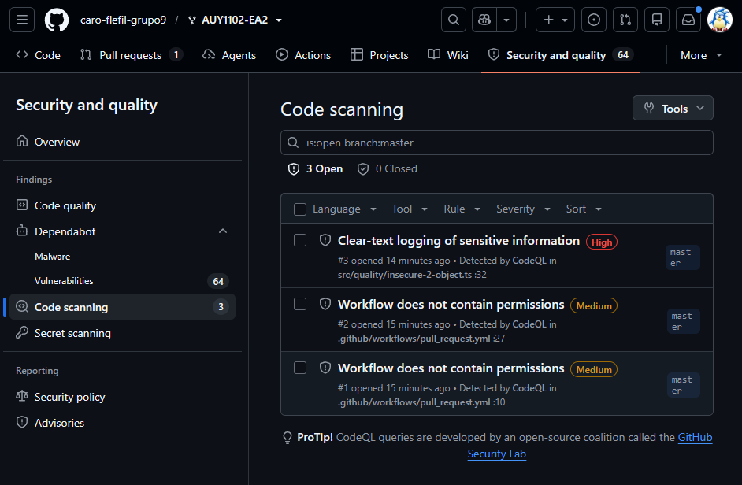
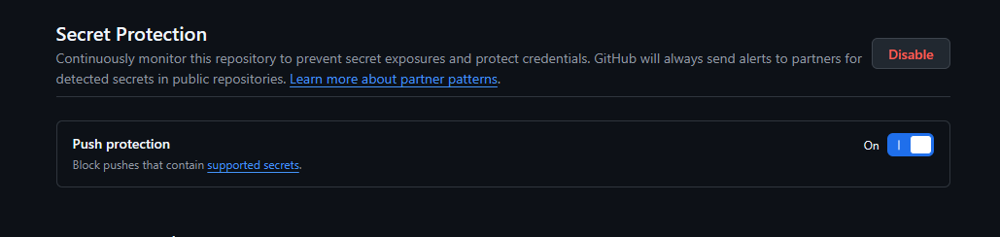

# Evaluación Parcial 2 — AUY1102
## Ciclo de Vida del Software I

---

## 1. Antecedentes
- **Institución:** Duoc UC
- **Asignatura:** Ciclo de Vida del Software I (AUY1102)
- **Integrantes:** 
  - Francisco Flefil
  - Javier Caro
- **Organización en GitHub:** [caro-flefil-grupo9](https://github.com/caro-flefil-grupo9)
- **Repositorio oficial:** [https://github.com/caro-flefil-grupo9/AUY1102-EA2](https://github.com/caro-flefil-grupo9/AUY1102-EA2)
- **Distribución de roles:**
  - **Francisco Flefil (Rama `ea2-pruebas-sonar`):** Pruebas unitarias, análisis de cobertura y análisis de código estático en SonarCloud.
  - **Javier Caro (Rama `ea2-snyk-seguridad`):** Análisis con Snyk, remediación del Dockerfile y revisión de GitHub Advanced Security.

### Evidencia del Repositorio

[Ver captura del repositorio](https://github.com/caro-flefil-grupo9/AUY1102-EA2/blob/master/evidencias/01-repositorio.png)
*Figura 1.1: Repositorio forkeado oficial en GitHub bajo la organización caro-flefil-grupo9.*

---

## 2. Pruebas unitarias y cobertura

### Procedimiento y Comandos Ejecutados
Para validar la suite de pruebas unitarias provista en el proyecto TypeScript con Jest, se utilizaron los siguientes comandos en el entorno local:
```bash
# Ejecución exclusiva de pruebas unitarias
npm run test:unit

# Ejecución de análisis de cobertura de código
npm run test:coverage

# Script único configurado para la evaluación
npm run test:evaluacion
```

### Resultados Obtenidos
- **Suites de Pruebas:** 10 suites ejecutadas, **10 pasadas exitosamente (100%)**, 0 fallidas.
- **Pruebas Unitarias:** 18 pruebas individuales ejecutadas, **18 pasadas exitosamente**, 0 errores.
- **Métricas de Cobertura Global (Jest):**
  - **Sentencias (% Stmts):** 39.72% (29/73)
  - **Ramas (% Branch):** 60.00% (6/10)
  - **Funciones (% Funcs):** 53.12% (17/32)
  - **Líneas (% Lines):** 39.72% (29/73)

### Detalle de Código No Cubierto
El análisis de Jest reveló que los siguientes componentes no cuentan con pruebas unitarias o su cobertura es parcial:
1. `src/quality/errores-object.ts`: **0.00% de cobertura** (líneas 2-6 sin pruebas asociadas).
2. `src/quality/insecure-1-object.ts`: **0.00% de cobertura** (líneas 1-28 sin pruebas).
3. `src/quality/insecure-2-object.ts`: **0.00% de cobertura** (líneas 1-32 sin pruebas).
4. `src/value-object/primitives/date-value-object.ts`: **6.66% de cobertura** (líneas 3-35 descubiertas).
5. `src/value-object/primitives/enum-value-object.ts`: **83.33% de cobertura** (línea 11 sin cubrir).
6. `src/index.ts`: **62.50% de cobertura** (líneas 8-10 descubiertas).

### Evidencias

[Ver captura de pruebas unitarias](https://github.com/caro-flefil-grupo9/AUY1102-EA2/blob/master/evidencias/02-pruebas-unitarias.png)
*Figura 2.1: Ejecución exitosa de las 18 pruebas unitarias sin fallos en terminal.*


[Ver captura de cobertura Jest](https://github.com/caro-flefil-grupo9/AUY1102-EA2/blob/master/evidencias/03-cobertura.png)
*Figura 2.2: Tabla de porcentaje de cobertura emitida por Jest detallando archivos y líneas sin cubrir.*

### Evidencia adicional: script de evaluación
Se agregó el script `test:evaluacion` en `package.json` para ejecutar las pruebas unitarias y generar el reporte de cobertura mediante un solo comando.

```bash
npm run test:evaluacion
```


[Ver captura del script](https://github.com/caro-flefil-grupo9/AUY1102-EA2/blob/master/evidencias-javier/script-evaluacion.png)

Commit: [614316f](https://github.com/caro-flefil-grupo9/AUY1102-EA2/commit/614316f1ebc436361a051a351fabc4b0e54ba271)

---

## 3. SonarCloud: Análisis y Remediación

### Integración y Análisis Inicial
El repositorio fue vinculado con la organización `caro-flefil-grupo9` en SonarCloud. La plataforma ejecutó el análisis estático identificando vulnerabilidades críticas en el código y en la configuración del proyecto.

### Hallazgos Detectados
Entre los hallazgos principales reportados por SonarCloud destacan:
1. **Fuga de Credenciales (Regla `secrets:S6689` - Blocker Vulnerability):**
   - **Archivo:** `credentials.yml` (Línea 1).
   - **Descripción:** Presencia de un Token de Acceso Personal (PAT) de GitHub hardcodeado en texto plano dentro del repositorio (`token: github_pat_...`).
2. **Server-Side Template Injection (Regla `tssecurity:S5496` / `typescript:S7790` - Blocker Vulnerability):**
   - **Archivo:** `src/quality/insecure-1-object.ts` (Línea 21).
   - **Descripción:** Concatenación directa de entrada de usuario (`req.body.username`) dentro de una plantilla Pug sin sanitizar ni parametrizar.
3. **Inconsistencia de Tipos en TypeScript:**
   - **Archivo:** `src/quality/errores-object.ts` (Línea 6).
   - **Descripción:** Asignación de un valor numérico (`10`) a una variable fuertemente tipada como `string`.

### Remediación Aplicada
Se realizaron las siguientes correcciones en la rama `ea2-pruebas-sonar`:
- **`credentials.yml`:** Se eliminó el token sensible hardcodeado y se reemplazó por la referencia a variable de entorno `${GITHUB_TOKEN}`, mitigando el riesgo de compromiso de credenciales.
- **`src/quality/insecure-1-object.ts`:** Se refactorizó la compilación de Pug a una plantilla estática parametrizada, pasando el valor del usuario como variable de contexto en `compiledTemplate({ username: input })`.
- **`src/quality/errores-object.ts`:** Se corrigió la asignación a `const message: string = '10';` y se agregaron las exportaciones correspondientes.

Tras la remediación, se ejecutaron nuevamente las pruebas unitarias y de cobertura confirmando su correcto funcionamiento, y se abrió el **Pull Request #1** hacia la rama `master`.

### Evidencias

[Ver captura del análisis inicial de SonarCloud](https://github.com/caro-flefil-grupo9/AUY1102-EA2/blob/master/evidencias/04-sonarcloud-inicial.png)
*Figura 3.1: Panel inicial de métricas y vulnerabilidades en SonarCloud.*


[Ver captura del hallazgo de SonarCloud](https://github.com/caro-flefil-grupo9/AUY1102-EA2/blob/master/evidencias/05-sonarcloud-hallazgo.png)
*Figura 3.2: Detalle de la vulnerabilidad detectada en SonarCloud (fuga de credenciales o SSTI).*


[Ver captura de remediación de SonarCloud](https://github.com/caro-flefil-grupo9/AUY1102-EA2/blob/master/evidencias/06-sonarcloud-remediacion.png)
*Figura 3.3: Verificación de la remediación y cierre del hallazgo en SonarCloud.*

Pull Request: [#1 — Pruebas y remediación](https://github.com/caro-flefil-grupo9/AUY1102-EA2/pull/1)

---

## 4. Snyk: Análisis de Dependencias y Código

### 4.1. Integración del repositorio
Se vinculó el repositorio AUY1102-EA2 con Snyk para analizar las dependencias del proyecto y la imagen utilizada en Docker.


[Ver captura de proyectos Snyk](https://github.com/caro-flefil-grupo9/AUY1102-EA2/blob/master/evidencias-javier/snyk-proyectos.png)

### 4.2. Vulnerabilidad detectada
Durante el análisis se identificó una vulnerabilidad de severidad alta asociada a la versión de Node.js utilizada en el Dockerfile.

Se detectó el uso de Node.js 14.21.3 mediante la imagen `node:14-alpine3.16`.


[Ver captura de vulnerabilidad](https://github.com/caro-flefil-grupo9/AUY1102-EA2/blob/master/evidencias-javier/snyk-vulnerabilidad.png)

### 4.3. Remediación del Dockerfile
Se actualizó la imagen base de Node.js para corregir el hallazgo detectado por Snyk.

Antes:

```dockerfile
FROM node:14-alpine3.16
```

Después:

```dockerfile
FROM node:20.20.0-alpine
```

Commit de la remediación: [fdb27a5](https://github.com/caro-flefil-grupo9/AUY1102-EA2/commit/fdb27a5e1a8b635e0c3ccc3a6bc0863b9ed180c3)

### 4.4. Verificación de la remediación
Después de actualizar el Dockerfile, se realizó una nueva revisión en Snyk para comprobar el estado de la imagen actualizada.


[Ver captura de verificación Snyk](https://github.com/caro-flefil-grupo9/AUY1102-EA2/blob/master/evidencias-javier/snyk-remediacion-verificada.png)

Pull Request de la remediación: [#3](https://github.com/caro-flefil-grupo9/AUY1102-EA2/pull/3)

---

## 5. npm audit

### Procedimiento
Se ejecutó el comando de auditoría nativo de npm dentro del entorno local:
```bash
npm audit
```

### Resultados
- **Total de vulnerabilidades:** 82 problemas de seguridad detectados.
  - **Baja (Low):** 11
  - **Moderada (Moderate):** 20
  - **Alta (High):** 49
  - **Crítica (Critical):** 2
- **Paquetes más comprometidos:**
  - `tar` y `cacache` (Path Traversal y vulnerabilidades en extracción).
  - `chokidar` (versión 2.0.3 en desuso con avisos de fin de ciclo de soporte).
  - `@babel/core` y `@faker-js/faker` (ejecución de código arbitrario y ReDoS).
- **Acciones recomendadas:** Ejecución controlada de `npm audit fix` para remediaciones sin cambios disruptivos, y evaluación de actualización de librerías principales (`--force`).

### Evidencias

[Ver captura del reporte npm audit](https://github.com/caro-flefil-grupo9/AUY1102-EA2/blob/master/evidencias/07-npm-audit.png)
*Figura 5.1: Salida de npm audit en consola resumiendo las 82 vulnerabilidades por nivel de severidad.*

### Evidencia adicional de Javier
También se ejecutó `npm audit` desde el entorno local para revisar las vulnerabilidades presentes en las dependencias del proyecto.


[Ver captura adicional de npm audit](https://github.com/caro-flefil-grupo9/AUY1102-EA2/blob/master/evidencias-javier/npm-audit.png)

---

## 6. GitHub Advanced Security

### 6.1. Dependabot
Se verificó la configuración de Dependency Graph, Dependabot Alerts y Dependabot Security Updates para identificar dependencias vulnerables y recibir avisos de seguridad.


[Ver captura de Dependabot](https://github.com/caro-flefil-grupo9/AUY1102-EA2/blob/master/evidencias-javier/github-dependabot.png)

### 6.2. CodeQL
Se revisó la configuración de CodeQL mediante Default Setup y se comprobaron los resultados del análisis de código.


[Ver captura de configuración CodeQL](https://github.com/caro-flefil-grupo9/AUY1102-EA2/blob/master/evidencias-javier/github-codeql.png)


[Ver captura de resultados CodeQL](https://github.com/caro-flefil-grupo9/AUY1102-EA2/blob/master/evidencias-javier/github-codeql-resultados.png)

### 6.3. Secret Protection
Se revisó la sección Secret Protection de GitHub Advanced Security y la configuración de Push Protection, destinada a prevenir la incorporación de determinadas credenciales al repositorio.

La interfaz revisada no mostraba una opción independiente para habilitar Secret Scanning.


[Ver captura de Secret Protection](https://github.com/caro-flefil-grupo9/AUY1102-EA2/blob/master/evidencias-javier/github-secret-protection.png)

---

## 7. Conclusiones

1. **Aseguramiento Temprano de la Calidad:** Las pruebas unitarias permitieron validar que la lógica central de los Value Objects opera de manera confiable (18/18 pruebas superadas). Sin embargo, el análisis de cobertura evidenció que módulos críticos como `src/quality/` carecían totalmente de pruebas (0%), lo cual incrementa el riesgo de deuda técnica y fallos desapercibidos.
2. **Detección Estática vs Dependencias:** La integración combinada de SonarCloud y Snyk demostró ser complementaria: mientras SonarCloud detectó malas prácticas de desarrollo y fugas de secretos (`credentials.yml`), Snyk y `npm audit` visibilizaron la vulnerabilidad de la cadena de suministro por dependencias externas desactualizadas (82 alertas).
3. **Automatización en el Ciclo de Vida:** La revisión de las herramientas de GitHub Advanced Security y la integración de cambios mediante Pull Requests contribuyen a un ciclo de entrega continua (DevSecOps) más controlado.

---

## 8. Enlaces de Entrega

- **Repositorio oficial de código:** [https://github.com/caro-flefil-grupo9/AUY1102-EA2](https://github.com/caro-flefil-grupo9/AUY1102-EA2)
- **Pull Requests fusionados:**
  - [PR #1 — Pruebas y remediación](https://github.com/caro-flefil-grupo9/AUY1102-EA2/pull/1)
  - [PR #2 — Documentación y evidencias técnicas](https://github.com/caro-flefil-grupo9/AUY1102-EA2/pull/2)
  - [PR #3 — Remediación de Snyk](https://github.com/caro-flefil-grupo9/AUY1102-EA2/pull/3)
  - [PR #5 — Evidencias](https://github.com/caro-flefil-grupo9/AUY1102-EA2/pull/5)
- **Historial de commits de master:** [Ver historial](https://github.com/caro-flefil-grupo9/AUY1102-EA2/commits/master/)
- **Documento Markdown entregable:** [https://github.com/caro-flefil-grupo9/AUY1102-EA2/blob/master/EVALUACION_EA2.md](https://github.com/caro-flefil-grupo9/AUY1102-EA2/blob/master/EVALUACION_EA2.md)

Se utilizaron ramas independientes, commits y `push` para proponer las modificaciones mediante Pull Requests y facilitar su revisión e integración.
