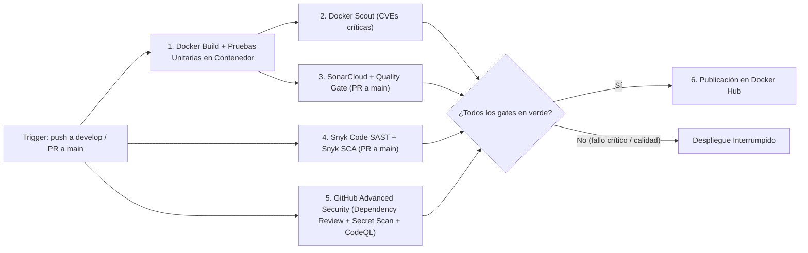
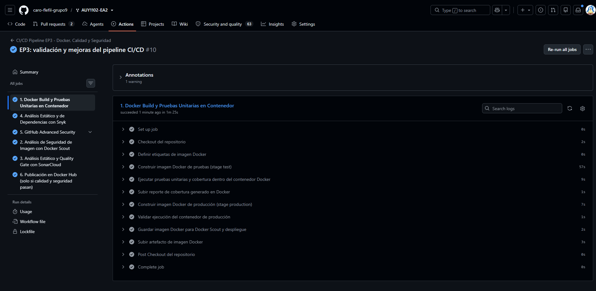
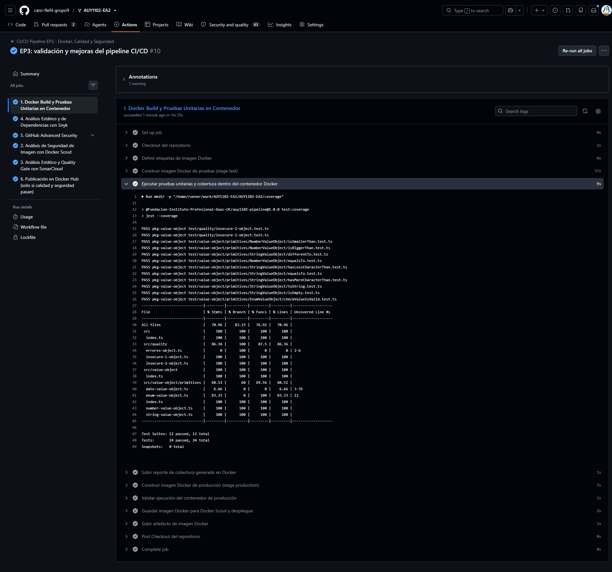
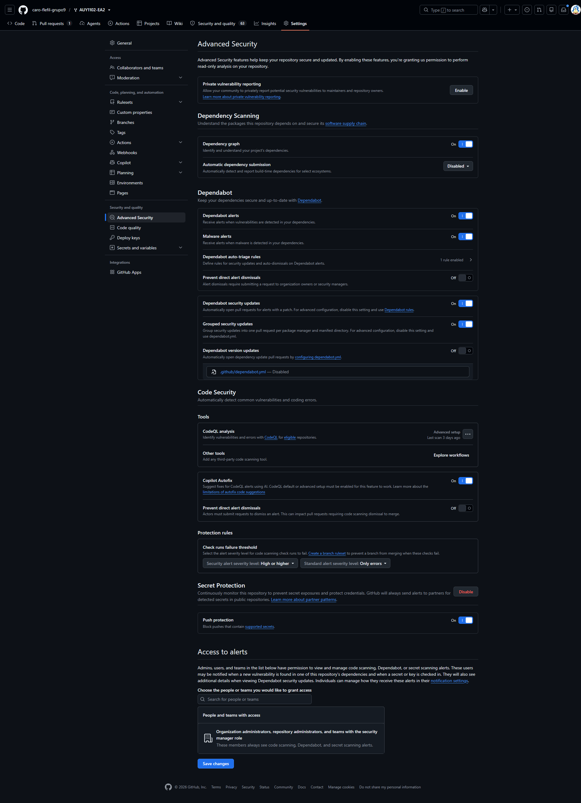
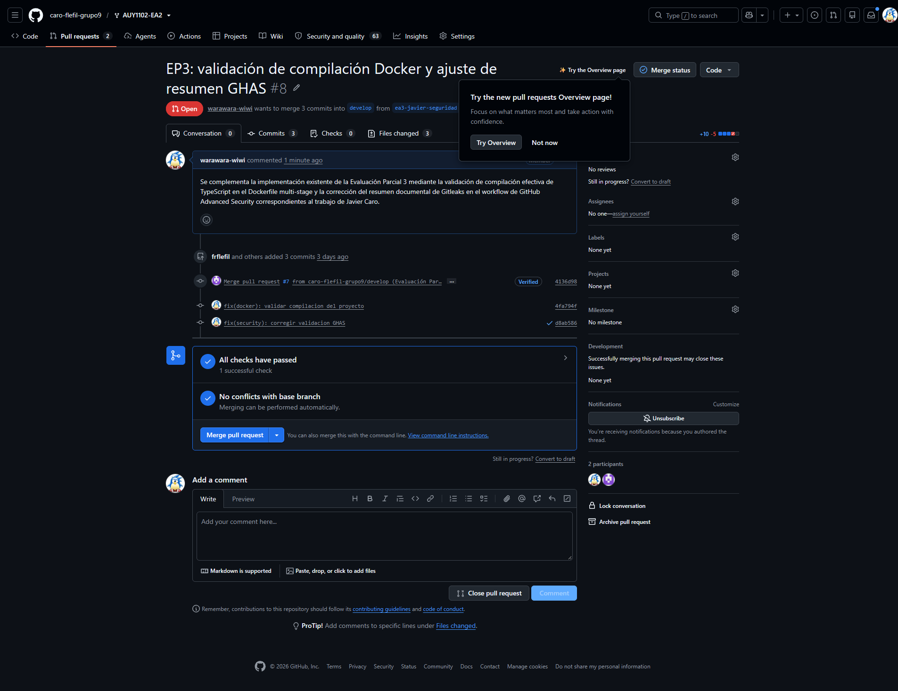
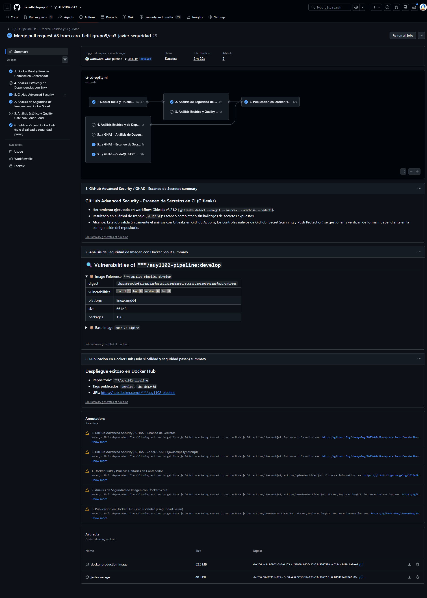
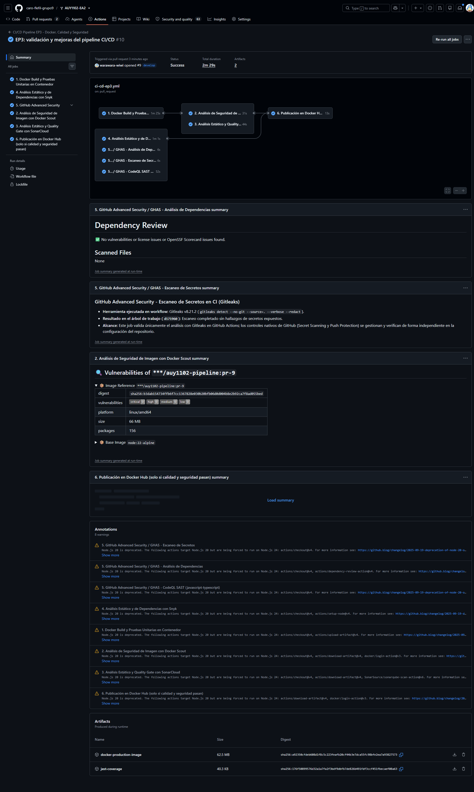
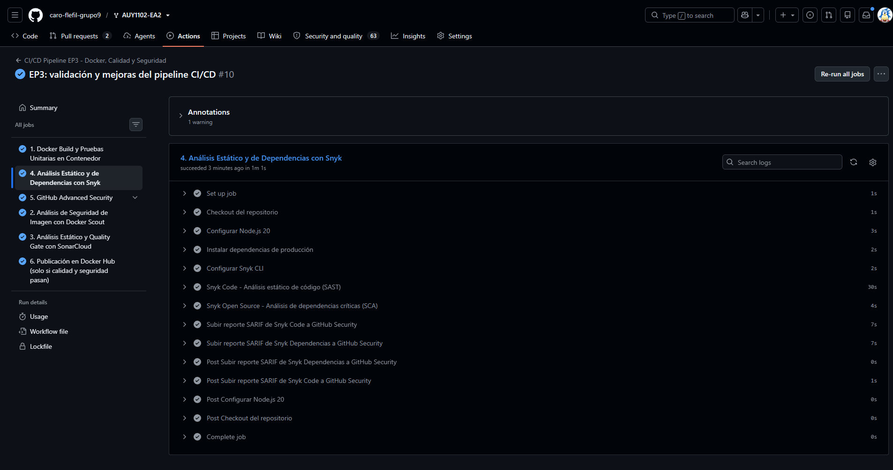
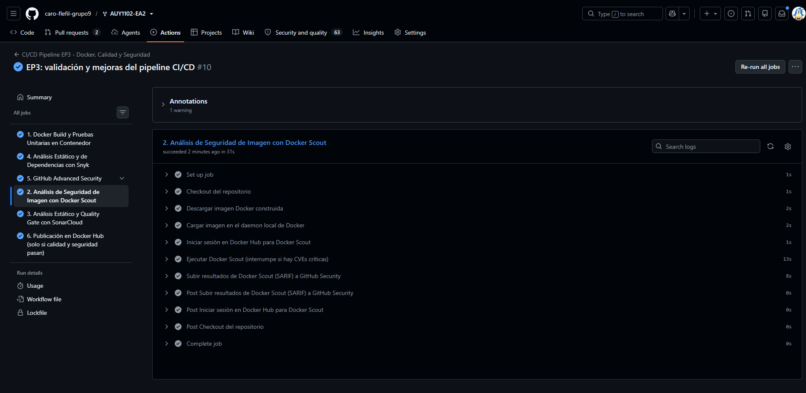
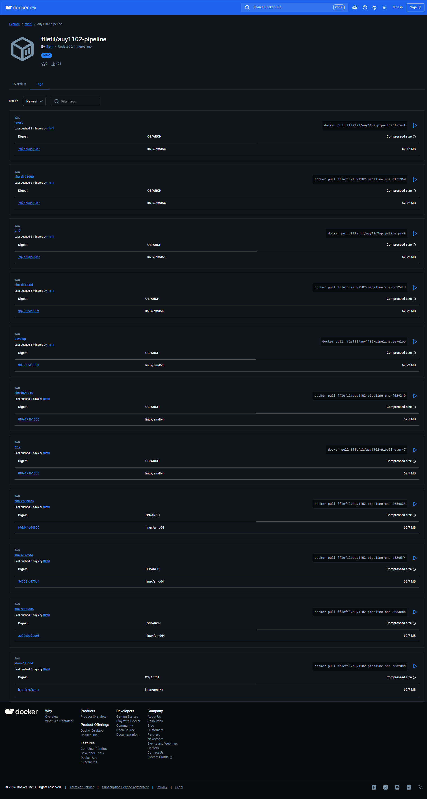

# Evaluación Parcial 3 — AUY1102
## Aseguramiento de la Calidad del Software con GitHub y GitHub Actions II

---

## 1. Antecedentes

- **Institución:** Duoc UC
- **Asignatura:** Ciclo de Vida del Software I (AUY1102)
- **Evaluación:** Evaluación Parcial N° 3 (40% de ponderación)
- **Integrantes:**
  - Francisco Flefil
  - Javier Caro
- **Organización en GitHub:** [caro-flefil-grupo9](https://github.com/caro-flefil-grupo9)
- **Repositorio oficial (público):** [https://github.com/caro-flefil-grupo9/AUY1102-EA2](https://github.com/caro-flefil-grupo9/AUY1102-EA2)
- **Repositorio base (fork upstream):** [Fundacion-Instituto-Profesional-Duoc-UC/AUY1102-Pipeline](https://github.com/Fundacion-Instituto-Profesional-Duoc-UC/AUY1102-Pipeline)
- **Registro de imágenes en Docker Hub:** [https://hub.docker.com/r/fflefil/auy1102-pipeline](https://hub.docker.com/r/fflefil/auy1102-pipeline)
- **Proyecto en SonarCloud:** [caro-flefil-grupo9_AUY1102-EA2](https://sonarcloud.io/project/overview?id=caro-flefil-grupo9_AUY1102-EA2)

### Estrategia de Ramas (Continuación de EP2)
- **`master`**: se mantiene intacta con el historial y entregables de la Evaluación Parcial 2 ([EVALUACION_EA2.md](EVALUACION_EA2.md)).
- **`develop`**: rama de integración donde se desarrolla y valida continuamente cada `push` con construcción Docker, pruebas unitarias dentro del contenedor, Docker Scout, GitHub Advanced Security y publicación en Docker Hub (`develop` / `sha-<commit>`).
- **`main`**: rama principal integrada mediante Pull Requests desde `develop` (sin reglas activas de protección de rama en `Settings → Branches`, gestionando la integración controlada mediante flujo de PR), donde se ejecuta el pipeline completo de calidad y seguridad (incluyendo SonarCloud, Snyk, Dependency Review, Escaneo de Secretos, CodeQL y Docker Scout) antes de autorizar el despliegue (`pr-<n>` / `latest`).

---

## 2. Arquitectura del Pipeline CI/CD

El pipeline está organizado en dos workflows modulares dentro de `.github/workflows/`:
1. **[`.github/workflows/ci-cd-ep3.yml`](.github/workflows/ci-cd-ep3.yml)**: workflow principal disparado en `push` a `develop`, `pull_request` a `main` y `workflow_dispatch`.
2. **[`.github/workflows/ghas-security.yml`](.github/workflows/ghas-security.yml)**: workflow reutilizable (`workflow_call`) invocado por el pipeline principal para ejecutar los controles de **GitHub Advanced Security**.

### Matriz de Disparadores y Gates

| Job / Control | `push` a `develop` | `pull_request` a `main` | Interrumpe despliegue si falla |
| :--- | :---: | :---: | :---: |
| 1. Docker Build + Pruebas Unitarias en Contenedor | Sí | Sí | Sí |
| 2. Docker Scout (CVEs críticas) | Sí | Sí | Sí (`exit-code: true`) |
| 3. SonarCloud (SAST + Quality Gate) | — | Sí | Sí (`sonar.qualitygate.wait=true`) |
| 4. Snyk (Snyk Code SAST + Dependencias críticas) | — | Sí | Sí (`--severity-threshold`) |
| 5a. GHAS — Dependency Review | — | Sí | Sí (`fail-on-severity: critical`) |
| 5b. GHAS — Escaneo de Secretos (Gitleaks + GHAS) | Sí | Sí | Sí |
| 5c. GHAS — CodeQL SAST (`javascript-typescript`) | Sí | Sí | Sí |
| 6. Publicación en Docker Hub | Solo si 1, 2 y 5 pasan | Solo si 1, 2, 3, 4 y 5 pasan | N/A |

---

## 3. Parte 1: Automatización con GitHub Actions y Docker

### 3.1 Dockerización Multi-Stage ([`Dockerfile`](Dockerfile) y [`.dockerignore`](.dockerignore))
Se diseñó un `Dockerfile` multi-stage con dos etapas diferenciadas:
- **Etapa `test` (`node:20.20.0-alpine`)**: actualiza paquetes de sistema (`apk upgrade --no-cache`), instala dependencias bloqueadas (`npm ci --ignore-scripts`) y ejecuta la suite completa de pruebas unitarias y cobertura con Jest **dentro del contenedor**.
- **Etapa `production` (`node:22-alpine`)**: actualiza paquetes del sistema operativo, instala únicamente dependencias de producción (`npm ci --omit=dev --ignore-scripts`), limpia caché y elimina los gestores de paquetes (`npm`, `corepack`, `yarn`) del entorno de ejecución final, copiando el código con propietario no privilegiado y ejecutando bajo **`USER node`** (cumpliendo buenas prácticas de contenedorización y eliminando la alerta `docker:S6471`).

### 3.2 Pruebas Unitarias y Cobertura Ejecutadas dentro del Contenedor
La ejecución dentro del contenedor Docker genera el reporte `coverage/lcov.info`, el cual se comparte como artefacto al job de SonarCloud:
- **Suites ejecutadas:** 12 de 12 aprobadas (**100%**)
- **Pruebas unitarias:** 24 de 24 aprobadas (**100%**)
- **Cobertura global alcanzada (Jest):**
  - Sentencias (`% Stmts`): **70.96%** (mejora desde 39.72% en EP2)
  - Ramas (`% Branch`): **83.33%** (mejora desde 60.00% en EP2)
  - Funciones (`% Funcs`): **76.92%** (mejora desde 53.12% en EP2)
  - Líneas (`% Lines`): **70.96%** (mejora desde 39.72% en EP2)

### 3.3 Publicación Automatizada en Docker Hub
El job `deploy-dockerhub` carga exactamente la misma imagen verificada por Docker Scout y la publica en `fflefil/auy1102-pipeline` únicamente cuando todos los controles previos finalizan en estado `success`:
- En `push` a `develop`: publica `develop` y `sha-<commit>`.
- En `pull_request` a `main`: publica `pr-<num>`, `sha-<commit>` y `latest`.

---

## 4. Parte 2: Análisis de Código, Seguridad y Bloqueo de Despliegue

### 4.1 SonarCloud ([`sonar-project.properties`](sonar-project.properties))
- Integrado con `SonarSource/sonarqube-scan-action@v6` en cada Pull Request hacia `main`, consumiendo el reporte `lcov.info` generado dentro del contenedor Docker.
- Configurado con `-Dsonar.qualitygate.wait=true` para bloquear el pipeline si el Quality Gate falla.
- **Resultados verificados en PR #7:**
  - **Quality Gate:** `OK` (Aprobado)
  - **Cobertura en código nuevo:** `100.0%` (umbral mínimo: `80%`)
  - **Nuevos Bugs / Vulnerabilidades / Code Smells:** `0` / `0` / `0`
  - **Duplicación en código nuevo:** `0.0%`
  - **Calificaciones (Reliability / Security / Maintainability):** `A` / `A` / `A`

### 4.2 Snyk (Análisis Estático y de Dependencias)
- Integrado mediante `snyk/actions/setup@master` en cada Pull Request hacia `main`:
  - **Snyk Code (SAST):** `snyk code test --org=frflefil --severity-threshold=high --sarif-file-output=snyk-code.sarif`
  - **Snyk Open Source (SCA):** `snyk test --org=frflefil --severity-threshold=critical --sarif-file-output=snyk-deps.sarif`
- Los resultados SARIF se suben automáticamente a la pestaña **Security → Code scanning** de GitHub. El análisis valida el cumplimiento de los umbrales configurados (`high` para Snyk Code SAST y `critical` para Snyk Open Source SCA sobre dependencias de producción `--omit=dev`).

### 4.3 GitHub Advanced Security ([`ghas-security.yml`](.github/workflows/ghas-security.yml) y [`.github/dependabot.yml`](.github/dependabot.yml))
- **Análisis de dependencias:** `actions/dependency-review-action@v4` en Pull Requests a `main` con `fail-on-severity: critical`, complementado con archivo [`.github/dependabot.yml`](.github/dependabot.yml) para ecosistemas `npm`, `docker` y `github-actions` y con **Dependency graph**, **Dependabot alerts** y **Dependabot security updates** habilitados en la configuración nativa del repositorio.
- **Escaneo de secretos:** se distingue entre (1) **GitHub Secret Protection y Push Protection**, habilitados de forma nativa en la configuración del repositorio (`Settings → Advanced Security`), y (2) **Gitleaks** (`gitleaks detect --no-git --source=. --verbose --redact`), ejecutado como job de CI en GitHub Actions con exclusión justificada en [`.gitleaksignore`](.gitleaksignore) únicamente para el identificador público `sonar.projectKey`.
- **Análisis estático CodeQL:** `github/codeql-action/init@v4` y `analyze@v4` para `javascript-typescript`.

### 4.4 Docker Scout
- Integrado con `docker/scout-action@v1` (`command: cves`, `only-severities: critical`, `exit-code: true`, `sarif-file: docker-scout.sarif`).
- **Resultado final sobre la imagen de producción endurecida (`node:22-alpine`):**
  - **Vulnerabilidades detectadas:** `0 Críticas`, `0 Altas`, `0 Medias`, `0 Bajas` (`No vulnerable packages detected`).
  - Reporte SARIF integrado en GitHub Code Scanning.

---

## 5. Evidencia Real de Interrupción del Despliegue y Remediaciones

Durante las pruebas en vivo en GitHub Actions, el pipeline demostró su capacidad de **interrumpir automáticamente el despliegue** ante hallazgos reales:

| Herramienta | Hallazgo que interrumpió el despliegue | Remediación aplicada | Resultado posterior |
| :--- | :--- | :--- | :--- |
| **Docker Scout** | `CVE-2026-59873` (CVSS 9.2 — **CRÍTICA**) en `pkg:npm/tar@6.2.1` dentro de la imagen base `node:20.20.0-alpine` (Run `#45207831991`). | Migración del stage `production` a `node:22-alpine`, actualización con `apk upgrade --no-cache`, eliminación de `npm`/`corepack`/`yarn` en runtime y ejecución con `USER node` (commit `a63f0dd`). | **0C / 0H / 0M / 0L** — Despliegue aprobado ✅ |
| **Snyk Code (SAST)** | Vulnerabilidad **HIGH** de Cross-Site Scripting (XSS) en `src/quality/insecure-1-object.ts` línea 24 (Run `#45208709318`). | Refactorización de `src/quality/insecure-1-object.ts` con sanitización estricta de entrada y escape HTML + suite de pruebas unitarias `test/quality/insecure-1-object.test.ts` (commit `e82c5f4`). | **0 issues HIGH/CRITICAL** — Snyk aprobado ✅ |
| **SonarCloud / Secret Scanning** | Credencial hardcodeada en `.npmrc` (`secrets:S6689`), secretos en `src/index.ts` y patrones inseguros (SQLi, XSS, contraseñas en texto plano) en `src/quality/insecure-2-object.ts`. | Sustitución por variables de entorno (`${NODE_AUTH_TOKEN}`), limpieza de `src/index.ts`, remediación segura en `src/quality/insecure-2-object.ts` y pruebas unitarias `test/quality/insecure-2-object.test.ts` (commit `92b90d7`). | **Quality Gate OK (100% cobertura en código nuevo)** ✅ |

### Ejecuciones Históricas Verificadas en Verde (Francisco Flefil)
- **Pull Request #7 (`develop` → `main`):** [Run #45210240824](https://github.com/caro-flefil-grupo9/AUY1102-EA2/actions/runs/45210240824) y [Run #45213732496](https://github.com/caro-flefil-grupo9/AUY1102-EA2/actions/runs/45213732496) — Todos los jobs (Docker Build + Tests, Docker Scout, SonarCloud, Snyk, GHAS Dependency Review, GHAS Secret Scanning, GHAS CodeQL y Deploy Docker Hub) en estado `success`.
- **Push a `develop`:** [Run #45210229303](https://github.com/caro-flefil-grupo9/AUY1102-EA2/actions/runs/45210229303) y [Run #45213717370](https://github.com/caro-flefil-grupo9/AUY1102-EA2/actions/runs/45213717370) — Todos los jobs aplicables en estado `success` con publicación en Docker Hub.

---

## 6. Integridad del Código y Consideraciones Éticas

- **Gestión segura de credenciales:** todas las claves (`DOCKERHUB_USERNAME`, `DOCKERHUB_TOKEN`, `SONAR_TOKEN`, `SNYK_TOKEN`) se almacenan exclusivamente como **GitHub Actions Repository Secrets** encriptados; ninguna credencial existe en el código fuente ni en los archivos de workflow.
- **Trazabilidad e integridad:** cada cambio fue validado mediante commits descriptivos, ramas separadas (`develop` y `main`), conservación intacta de `master` (EP2) y controles automatizados no evadibles antes de la publicación.
- **Mínimo privilegio:** los workflows declaran `permissions` explícitos por job (`contents: read`, `security-events: write`, `pull-requests: read`) y la imagen Docker final corre bajo usuario sin privilegios (`USER node`).

---

## 7. Cumplimiento de la Rúbrica

| Indicador | Peso | Evidencia en el repositorio |
| :--- | :---: | :--- |
| **IL4.1 / IE4.1.1:** Reconoce componentes de CI/CD, manteniendo la integridad del código y respetando consideraciones éticas, para automatizar procesos y reducir la intervención manual. | 33% | Separación de ramas (`develop`/`main`), uso exclusivo de *Repository Secrets*, eliminación de secretos hardcodeados (`.npmrc`, `src/index.ts`, `src/quality/insecure-2-object.ts`), mínimo privilegio en workflows y contenedores (`USER node`). |
| **IL4.2 / IE4.2.1:** Diseña pipelines de CI/CD, garantizando la calidad y la entrega continua del producto, para automatizar la compilación, prueba y despliegue de software en un contexto de desarrollo ágil. | 33% | Diseño modular con `Dockerfile` multi-stage, `.dockerignore`, `sonar-project.properties`, workflow principal (`ci-cd-ep3.yml`) y workflow reutilizable de seguridad (`ghas-security.yml`) con disparadores en `push` a `develop` y `pull_request` a `main`, y compuerta estricta antes de `deploy-dockerhub`. |
| **IL4.3 / IE4.3.1:** Implementa pipelines de CI/CD, para automatizar la compilación, prueba y despliegue de software en un contexto de desarrollo ágil, garantizando la calidad y la entrega continua del producto. | 34% | Ejecución real y verificada en verde en GitHub Actions (PR #7, PR #8, PR #9 y `develop`), compilación efectiva de TypeScript y pruebas ejecutadas dentro del contenedor Docker (24/24 aprobadas), SonarCloud Quality Gate OK (100% cobertura en código nuevo), Snyk Code + SCA OK bajo los umbrales configurados, GHAS OK, Docker Scout 0 CVEs críticas e imagen publicada en Docker Hub (`fflefil/auy1102-pipeline`). |

---

## Validaciones y evidencias adicionales — Javier Caro

Durante la intervención de **Javier Caro** (`warawara-wiwi`) desde la rama de trabajo `ea3-javier-seguridad`, se conservaron los workflows y remediaciones implementados previamente por Francisco Flefil y se efectuaron las siguientes validaciones técnicas, correcciones puntuales y capturas de evidencia real:

### 1. Compilación efectiva en Docker y ejecución del contenedor de producción

Se verificó la construcción de la imagen Docker multi-stage y se incorporó en [`Dockerfile`](Dockerfile) la compilación efectiva del proyecto TypeScript mediante `RUN npm run build` en la etapa `test`. En la etapa `production` (`node:22-alpine`) se copió el artefacto compilado `dist/` junto con `tslib` desde la etapa de construcción y se actualizó el comando final (`CMD`) para cargar `./dist/index.js` y comprobar en tiempo de ejecución los símbolos exportados por la librería (`EnumValueObject`, `NumberValueObject`, `StringValueObject`, `DateValueObject`).

- **Commit:** [`4fa794f` — `fix(docker): validar compilacion del proyecto`](https://github.com/caro-flefil-grupo9/AUY1102-EA2/commit/4fa794f314d57f3408e164b59d42831ba54d0c27)

[Ver captura](https://github.com/caro-flefil-grupo9/AUY1102-EA2/blob/main/evidencias-ea3-javier/01-docker-build.png)

[Ver job de construcción Docker en GitHub Actions](https://github.com/caro-flefil-grupo9/AUY1102-EA2/actions/runs/45897289432/job/140174232633)

### 2. Pruebas unitarias y cobertura dentro del contenedor Docker

Se ejecutaron las pruebas unitarias y el análisis de cobertura (`npm run test:coverage`) dentro del contenedor Docker tanto en validación local como en GitHub Actions, verificando **12 suites aprobadas** y **24 pruebas unitarias aprobadas** (70,96% de cobertura de sentencias y líneas, 83,33% de ramas y 76,92% de funciones).

[Ver captura](https://github.com/caro-flefil-grupo9/AUY1102-EA2/blob/main/evidencias-ea3-javier/02-pruebas-unitarias-docker.png)

[Ver job de pruebas unitarias en GitHub Actions](https://github.com/caro-flefil-grupo9/AUY1102-EA2/actions/runs/45897289432/job/140174232633)

### 3. Revisión de GitHub Advanced Security y precisión en Gitleaks

Se revisó la configuración de GitHub Advanced Security en el repositorio (`Settings → Advanced Security`) y se ajustó el paso de resumen en [`.github/workflows/ghas-security.yml`](.github/workflows/ghas-security.yml) para registrar únicamente el resultado real del análisis ejecutado por **Gitleaks v8.21.2** en GitHub Actions, distinguiéndolo de los controles nativos del repositorio (**GitHub Secret Protection** y **Push Protection**, verificados como activos en la interfaz de configuración de GitHub junto con **Dependency graph**, **Dependabot alerts** y **Dependabot security updates**).

- **Commit:** [`d8ab586` — `fix(security): corregir validacion GHAS`](https://github.com/caro-flefil-grupo9/AUY1102-EA2/commit/d8ab5863c917a298685a63349c3b371b2fa52063)

[Ver captura](https://github.com/caro-flefil-grupo9/AUY1102-EA2/blob/main/evidencias-ea3-javier/04-github-advanced-security.png)

[Ver job de Gitleaks en GitHub Actions](https://github.com/caro-flefil-grupo9/AUY1102-EA2/actions/runs/45897289432/job/140174232753)

[Ver job de Dependency Review en GitHub Actions](https://github.com/caro-flefil-grupo9/AUY1102-EA2/actions/runs/45897289432/job/140174232557)

[Ver job de CodeQL SAST en GitHub Actions](https://github.com/caro-flefil-grupo9/AUY1102-EA2/actions/runs/45897289432/job/140174232561)

### 4. Integración mediante Pull Request hacia `develop` y ejecución del pipeline en `develop`

Se creó y fusionó mediante la interfaz gráfica de GitHub el Pull Request #8 (`ea3-javier-seguridad` → `develop`), comprobando la activación automática del pipeline por evento `push` sobre la rama `develop`.

- **Pull Request hacia `develop`:** [PR #8 — `EP3: validación de compilación Docker y ajuste de resumen GHAS`](https://github.com/caro-flefil-grupo9/AUY1102-EA2/pull/8)
- **Commit de merge en `develop`:** [`dd124fd`](https://github.com/caro-flefil-grupo9/AUY1102-EA2/commit/dd124fd8522bc361ff338f5be8771e8364470807)

[Ver captura del Pull Request #8](https://github.com/caro-flefil-grupo9/AUY1102-EA2/blob/main/evidencias-ea3-javier/08-pull-request-javier.png)

[Ver captura del pipeline en develop](https://github.com/caro-flefil-grupo9/AUY1102-EA2/blob/main/evidencias-ea3-javier/10-pipeline-develop.png)

[Ver ejecución de GitHub Actions en develop (Run #45896939621)](https://github.com/caro-flefil-grupo9/AUY1102-EA2/actions/runs/45896939621)

### 5. Ejecución completa del pipeline mediante Pull Request hacia `main`

Se comprobó la ejecución completa de los controles correspondientes al pipeline CI/CD mediante el Pull Request #9 (`develop` → `main`), verificando que todos los jobs obligatorios (Docker Build y pruebas en contenedor, Docker Scout, SonarCloud Quality Gate, Snyk Code y Snyk Open Source, GHAS Dependency Review, GHAS Escaneo de Secretos, GHAS CodeQL y publicación en Docker Hub) finalizaron en estado `success`.

- **Pull Request hacia `main`:** [PR #9 — `EP3: validación y mejoras del pipeline CI/CD`](https://github.com/caro-flefil-grupo9/AUY1102-EA2/pull/9)

[Ver captura](https://github.com/caro-flefil-grupo9/AUY1102-EA2/blob/main/evidencias-ea3-javier/03-pipeline-github-actions.png)

[Ver ejecución completa de GitHub Actions (Run #45897289432)](https://github.com/caro-flefil-grupo9/AUY1102-EA2/actions/runs/45897289432)

[Ver job de SonarCloud Quality Gate](https://github.com/caro-flefil-grupo9/AUY1102-EA2/actions/runs/45897289432/job/140174798537)

### 6. Análisis de seguridad con Snyk y Docker Scout

Se verificó la ejecución de **Snyk Code (SAST)** (`--severity-threshold=high`) y **Snyk Open Source (SCA)** (`--severity-threshold=critical`) junto con el análisis de vulnerabilidades críticas de imagen mediante **Docker Scout** (`0C / 0H / 0M / 0L`).

[Ver captura de Snyk](https://github.com/caro-flefil-grupo9/AUY1102-EA2/blob/main/evidencias-ea3-javier/05-snyk-analisis.png)

[Ver job de Snyk en GitHub Actions](https://github.com/caro-flefil-grupo9/AUY1102-EA2/actions/runs/45897289432/job/140174232271)

[Ver captura de Docker Scout](https://github.com/caro-flefil-grupo9/AUY1102-EA2/blob/main/evidencias-ea3-javier/06-docker-scout.png)

[Ver job de Docker Scout en GitHub Actions](https://github.com/caro-flefil-grupo9/AUY1102-EA2/actions/runs/45897289432/job/140174798540)

### 7. Publicación verificada en Docker Hub

Se verificó la publicación automática de las imágenes validadas en el repositorio público de Docker Hub [`fflefil/auy1102-pipeline`](https://hub.docker.com/r/fflefil/auy1102-pipeline/tags) con las etiquetas correspondientes (`develop`, `pr-9`, `sha-d171960` / `sha-dd124fd` y `latest`).

[Ver captura de Docker Hub](https://github.com/caro-flefil-grupo9/AUY1102-EA2/blob/main/evidencias-ea3-javier/07-dockerhub-publicacion.png)

[Ver job de publicación en Docker Hub](https://github.com/caro-flefil-grupo9/AUY1102-EA2/actions/runs/45897289432/job/140175109306)

[Ver repositorio en Docker Hub](https://hub.docker.com/r/fflefil/auy1102-pipeline/tags)
